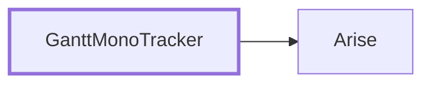

<!-- generated by Documentize RepoDocs @ 45dc6ae0049560c6948c19e6cfa8952044b68b0e -->
# Architecture

## Layers

Projects by how many layers of other projects in this repository they build on: layer 0 depends on none of them.

| Layer | Projects |
|---:|---|
| 0 | [Arise](projects/Arise.md) |
| 1 | [GanttMonoTracker](projects/GanttMonoTracker.md) |

## Project dependencies

## Projects

| Project | Kind | Frameworks | Depends on | Used by | Public types |
|---|---|---|---:|---:|---:|
| [Arise](projects/Arise.md) | Library |  | 0 | 1 | 2 |
| [GanttMonoTracker](projects/GanttMonoTracker.md) | App |  | 1 | 0 | 73 |

## Component families

The 11 most important of 11; see [all families](families/index.md).

| Root | Implementations | Project |
|---|---:|---|
| [`IGuiMessageDialog`](families/IGuiMessageDialog.md) | 11 | GanttMonoTracker |
| [`IManagerEntity`](families/IManagerEntity.md) | 6 | GanttMonoTracker |
| [`IStorageCommand`](families/IStorageCommand.md) | 4 | GanttMonoTracker |
| [`IGuiSource`](families/IGuiSource.md) | 4 | GanttMonoTracker |
| [`IStorageManager`](families/IStorageManager.md) | 3 | GanttMonoTracker |
| [`ITaskManager`](families/ITaskManager.md) | 2 | GanttMonoTracker |
| [`ITask`](families/ITask.md) | 3 | GanttMonoTracker |
| [`IGuiCore`](families/IGuiCore.md) | 2 | GanttMonoTracker |
| [`IGuiTracker`](families/IGuiTracker.md) | 2 | GanttMonoTracker |
| [`IGuiConnection`](families/IGuiConnection.md) | 2 | GanttMonoTracker |
| [`IState`](families/IState.md) | 2 | GanttMonoTracker |
