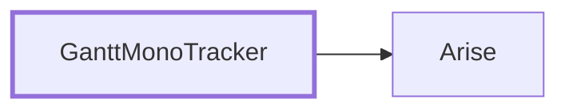

<!-- generated by Documentize RepoDocs @ 45dc6ae0049560c6948c19e6cfa8952044b68b0e -->
# Architecture

## How it fits together

*Written by AI from the code at this commit. Check important details against the source.*

The `Arise` library supplies core services such as data searching and identity management. `GanttMonoTracker` builds the desktop UI, injecting [`IGuiCore`](api/TaskManagerInterface/IGuiCore.md), [`ITaskManager`](api/TaskManagerInterface/ITaskManager.md), and [`IStorageManager`](api/TaskManagerInterface/IStorageManager.md) implementations from `Arise` where needed. When a user creates or edits a task, the UI dialog calls [`IGuiCore`](api/TaskManagerInterface/IGuiCore.md) → [`ITaskManager`](api/TaskManagerInterface/ITaskManager.md) to bind data, then [`IStorageManager`](api/TaskManagerInterface/IStorageManager.md) persists the changes via an [`IStorageRepository`](api/TaskManagerInterface/IStorageRepository.md).

| Part | Projects | Role |
|---|---|---|
| Core | [Arise](projects/Arise.md) | Provides shared business logic, search utilities, and authentication services. |
| Application | [GanttMonoTracker](projects/GanttMonoTracker.md) | Implements the graphical interface, task management, and storage integration using the core contracts. |

### Extending it

The system is extensible through component families such as [`IGuiMessageDialog`](api/TaskManagerInterface/IGuiMessageDialog.md), [`IManagerEntity`](api/TaskManagerInterface/IManagerEntity.md), [`IGuiSource`](api/TaskManagerInterface/IGuiSource.md), [`IStorageManager`](api/TaskManagerInterface/IStorageManager.md), [`ITaskManager`](api/TaskManagerInterface/ITaskManager.md), [`ITask`](api/TaskManagerInterface/ITask.md), [`IGuiCore`](api/TaskManagerInterface/IGuiCore.md), [`IGuiTracker`](api/TaskManagerInterface/IGuiTracker.md), [`IGuiConnection`](api/TaskManagerInterface/IGuiConnection.md), and [`IState`](api/TaskManagerInterface/IState.md). New implementations can be added for any of these interfaces to supply alternative dialogs, storage back‑ends, or UI representations without modifying existing code.

## Layers

Projects by how many layers of other projects in this repository they build on: layer 0 depends on none of them.

| Layer | Projects |
|---:|---|
| 0 | [Arise](projects/Arise.md) |
| 1 | [GanttMonoTracker](projects/GanttMonoTracker.md) |

## Project dependencies

## Projects

| Project | Kind | Frameworks | Depends on | Used by | Public types |
|---|---|---|---:|---:|---:|
| [Arise](projects/Arise.md) | Library |  | 0 | 1 | 2 |
| [GanttMonoTracker](projects/GanttMonoTracker.md) | App |  | 1 | 0 | 73 |

## Component families

The 11 most important of 11; see [all families](families/index.md).

| Root | Implementations | Project |
|---|---:|---|
| [`IGuiMessageDialog`](families/IGuiMessageDialog.md) | 11 | GanttMonoTracker |
| [`IManagerEntity`](families/IManagerEntity.md) | 6 | GanttMonoTracker |
| [`IStorageCommand`](families/IStorageCommand.md) | 4 | GanttMonoTracker |
| [`IGuiSource`](families/IGuiSource.md) | 4 | GanttMonoTracker |
| [`IStorageManager`](families/IStorageManager.md) | 3 | GanttMonoTracker |
| [`ITaskManager`](families/ITaskManager.md) | 2 | GanttMonoTracker |
| [`ITask`](families/ITask.md) | 3 | GanttMonoTracker |
| [`IGuiCore`](families/IGuiCore.md) | 2 | GanttMonoTracker |
| [`IGuiTracker`](families/IGuiTracker.md) | 2 | GanttMonoTracker |
| [`IGuiConnection`](families/IGuiConnection.md) | 2 | GanttMonoTracker |
| [`IState`](families/IState.md) | 2 | GanttMonoTracker |
