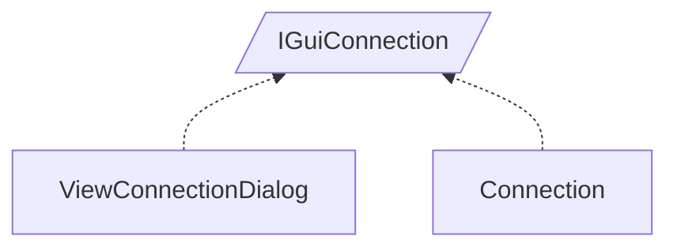

<!-- generated by Documentize RepoDocs @ 45dc6ae0049560c6948c19e6cfa8952044b68b0e -->
# IGuiConnection

Interface [`IGuiConnection`](../api/TaskManagerInterface/IGuiConnection.md) in [GanttMonoTracker](../projects/GanttMonoTracker.md), with 2 types that implement or derive from it.

## How this family works

*Written by AI from the code at this commit. Check important details against the source.*

[`IGuiConnection`](../api/TaskManagerInterface/IGuiConnection.md) defines a data contract for UI elements that represent a connection between tasks: it exposes identifiers (`MappingID`, `StateID`), a display `Name`, a `TaskStateSource` data set, and two lifecycle methods `BindStateIn` and `BindStateOut` that let the UI bind its input and output state controls.

### Variants

| Type | Differs by | Use when |
|---|---|---|
| [`GanttMonoTracker.GuiPresentation.ViewConnectionDialog`](../api/GanttMonoTracker.GuiPresentation/ViewConnectionDialog.md) | Implements [`IGuiConnection`](../api/TaskManagerInterface/IGuiConnection.md) as a dialog UI; contains Glade widgets, builds a modal window, and wires UI events to populate the contract fields. | When a user must create or edit a connection through a graphical dialog. |
| [`GanttTracker.StateManager.Connection`](../api/GanttTracker.StateManager/Connection.md) | Implements [`IGuiConnection`](../api/TaskManagerInterface/IGuiConnection.md) as a plain data entity used by the state manager; adds persistence members (`Id`, `IsNew`, `isUpdated`) and implements [`IManagerEntity`](../api/TaskManagerInterface/IManagerEntity.md) for CRUD operations. | When the application needs a non‑UI representation of a connection for storage, synchronization, or business‑logic processing. |

### Adding a variant

To add a new variant, create a class that implements [`IGuiConnection`](../api/TaskManagerInterface/IGuiConnection.md). Provide concrete implementations for the properties and the two bind methods. If the variant needs additional behavior (e.g., persistence, validation), also implement the relevant interfaces such as [`IManagerEntity`](../api/TaskManagerInterface/IManagerEntity.md) and add the required members.

### Creating and registering

No DI registrations are defined for the existing implementations; they are instantiated directly (`new ViewConnectionDialog(...)` for the UI and `new Connection(...)` for the data entity).

**Pitfalls**

- [`ViewConnectionDialog`](../api/GanttMonoTracker.GuiPresentation/ViewConnectionDialog.md) tightly couples UI layout (Glade) to the contract; changes to the dialog UI require updating the implementation.
- [`Connection`](../api/GanttTracker.StateManager/Connection.md) mixes UI contract with persistence logic; modifications to storage semantics may affect the contract implementation.

## Types

| Type | Kind | Level | Project | |
|---|---|---:|---|---|
| [`ViewConnectionDialog`](../api/GanttMonoTracker.GuiPresentation/ViewConnectionDialog.md) | Class | 1 | GanttMonoTracker |  |
| [`Connection`](../api/GanttTracker.StateManager/Connection.md) | Class | 1 | GanttMonoTracker |  |
