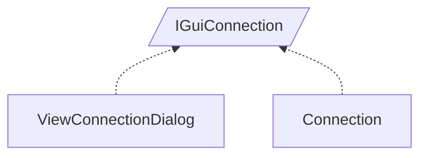

<!-- generated by Documentize RepoDocs @ 45dc6ae0049560c6948c19e6cfa8952044b68b0e -->
# IGuiConnection

Interface [`IGuiConnection`](../api/TaskManagerInterface/IGuiConnection.md) in [GanttMonoTracker](../projects/GanttMonoTracker.md), with 2 types that implement or derive from it.

## Types

| Type | Kind | Level | Project | |
|---|---|---:|---|---|
| [`ViewConnectionDialog`](../api/GanttMonoTracker.GuiPresentation/ViewConnectionDialog.md) | Class | 1 | GanttMonoTracker |  |
| [`Connection`](../api/GanttTracker.StateManager/Connection.md) | Class | 1 | GanttMonoTracker |  |
