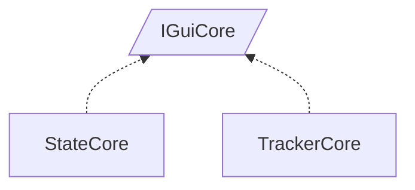

<!-- generated by Documentize RepoDocs @ 45dc6ae0049560c6948c19e6cfa8952044b68b0e -->
# IGuiCore

Interface [`IGuiCore`](../api/TaskManagerInterface/IGuiCore.md) in [GanttMonoTracker](../projects/GanttMonoTracker.md), with 2 types that implement or derive from it.

## How this family works

*Written by AI from the code at this commit. Check important details against the source.*

IGuiCore defines the minimal contract for a GUI core: it must expose the current [`CoreState`](../api/TaskManagerInterface/CoreState.md), a [`IStateManager`](../api/TaskManagerInterface/IStateManager.md) to manipulate states, a [`IStorageManager`](../api/TaskManagerInterface/IStorageManager.md) to persist data, and a [`ITaskManager`](../api/TaskManagerInterface/ITaskManager.md) to handle tasks. The family exists to provide concrete cores for different concerns – one for overall project tracking and another for state‑specific management – while sharing the same public API.

### Variants

| Type | Differs by | Use when |
|---|---|---|
| [`TrackerCore`](../api/GanttTracker/TrackerCore.md) | Acts as a singleton that owns the main window, recent‑file handling, and binds the project (creates the [`ITaskManager`](../api/TaskManagerInterface/ITaskManager.md) via [`ManagerFactory`](../api/GanttTracker.TaskManager/ManagerFactory.md)). It also exposes an [`IGuiTracker`](../api/TaskManagerInterface/IGuiTracker.md) for task/actor UI. | Use when the application needs the primary tracking UI, project loading/saving, and a single shared core instance. |
| [`StateCore`](../api/GanttTracker.StateManager/StateCore.md) | Implements both [`IGuiCore`](../api/TaskManagerInterface/IGuiCore.md) and [`IStateManager`](../api/TaskManagerInterface/IStateManager.md); it is constructed with an existing [`IGuiCore`](../api/TaskManagerInterface/IGuiCore.md) and a GUI state view, and focuses on creating/editing task states, delegating storage to the passed core. | Use when a separate core is required for state‑management dialogs or when you need a dedicated [`IStateManager`](../api/TaskManagerInterface/IStateManager.md) that reuses the existing task and storage managers. |

### Adding a variant

Create a new class that implements [`IGuiCore`](../api/TaskManagerInterface/IGuiCore.md) (and any additional manager interfaces it should provide). Implement the four properties and any extra behavior needed. If the variant should be discoverable via DI, add a registration like services.AddSingleton&lt;IGuiCore, YourImplementation&gt;() or expose a static `Instance` similar to [`TrackerCore`](../api/GanttTracker/TrackerCore.md).

### Creating and registering

The existing cores are not registered through a DI container; [`TrackerCore`](../api/GanttTracker/TrackerCore.md) is accessed via its static `Instance` property, while [`StateCore`](../api/GanttTracker.StateManager/StateCore.md) is instantiated directly where needed (e.g., new StateCore(guiCore, guiState)). To add a new variant, register it in the composition root with the appropriate DI call or provide a factory method.

**Pitfalls**

- Both cores expose mutable properties; changing them after the core is in use can lead to inconsistent state.
- [`TrackerCore`](../api/GanttTracker/TrackerCore.md) is a singleton; creating multiple instances manually will break the intended single‑instance semantics.
- [`StateCore`](../api/GanttTracker.StateManager/StateCore.md) expects a fully initialized [`IGuiCore`](../api/TaskManagerInterface/IGuiCore.md) and a GUI state view; passing null or an incompletely configured core will cause runtime errors.

## Types

| Type | Kind | Level | Project | |
|---|---|---:|---|---|
| [`StateCore`](../api/GanttTracker.StateManager/StateCore.md) | Class | 1 | GanttMonoTracker |  |
| [`TrackerCore`](../api/GanttTracker/TrackerCore.md) | Class | 1 | GanttMonoTracker |  |
