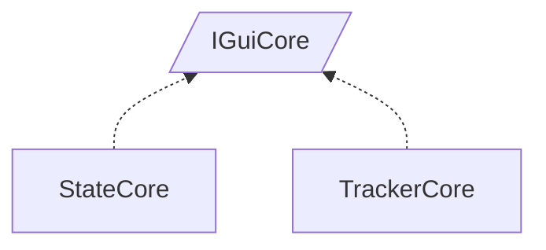

<!-- generated by Documentize RepoDocs @ 45dc6ae0049560c6948c19e6cfa8952044b68b0e -->
# IGuiCore

Interface [`IGuiCore`](../api/TaskManagerInterface/IGuiCore.md) in [GanttMonoTracker](../projects/GanttMonoTracker.md), with 2 types that implement or derive from it.

## Types

| Type | Kind | Level | Project | |
|---|---|---:|---|---|
| [`StateCore`](../api/GanttTracker.StateManager/StateCore.md) | Class | 1 | GanttMonoTracker |  |
| [`TrackerCore`](../api/GanttTracker/TrackerCore.md) | Class | 1 | GanttMonoTracker |  |
