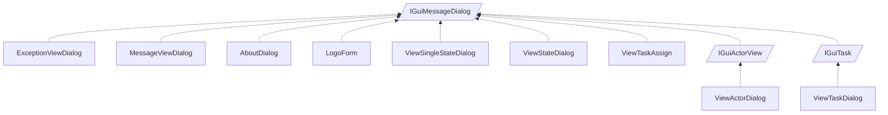

<!-- generated by Documentize RepoDocs @ 45dc6ae0049560c6948c19e6cfa8952044b68b0e -->
# IGuiMessageDialog

Interface [`IGuiMessageDialog`](../api/TaskManagerInterface/IGuiMessageDialog.md) in [GanttMonoTracker](../projects/GanttMonoTracker.md), with 11 types that implement or derive from it.

## Types

| Type | Kind | Level | Project | |
|---|---|---:|---|---|
| [`ExceptionViewDialog`](../api/GanttMonoTracker.ExceptionPresentation/ExceptionViewDialog.md) | Class | 1 | GanttMonoTracker |  |
| [`MessageViewDialog`](../api/GanttMonoTracker.ExceptionPresentation/MessageViewDialog.md) | Class | 1 | GanttMonoTracker |  |
| [`AboutDialog`](../api/GanttMonoTracker.GuiPresentation/AboutDialog.md) | Class | 1 | GanttMonoTracker |  |
| [`LogoForm`](../api/GanttMonoTracker.GuiPresentation/LogoForm.md) | Class | 1 | GanttMonoTracker |  |
| [`ViewSingleStateDialog`](../api/GanttMonoTracker.GuiPresentation/ViewSingleStateDialog.md) | Class | 1 | GanttMonoTracker |  |
| [`ViewStateDialog`](../api/GanttMonoTracker.GuiPresentation/ViewStateDialog.md) | Class | 1 | GanttMonoTracker |  |
| [`ViewTaskAssign`](../api/GanttMonoTracker.GuiPresentation/ViewTaskAssign.md) | Class | 1 | GanttMonoTracker |  |
| [`IGuiActorView`](../api/TaskManagerInterface/IGuiActorView.md) | Interface | 1 | GanttMonoTracker |  |
| [`IGuiTask`](../api/TaskManagerInterface/IGuiTask.md) | Interface | 1 | GanttMonoTracker |  |
| [`ViewActorDialog`](../api/GanttMonoTracker.GuiPresentation/ViewActorDialog.md) | Class | 2 | GanttMonoTracker |  |
| [`ViewTaskDialog`](../api/GanttMonoTracker.GuiPresentation/ViewTaskDialog.md) | Class | 2 | GanttMonoTracker |  |
