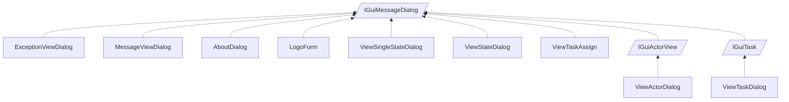

<!-- generated by Documentize RepoDocs @ 45dc6ae0049560c6948c19e6cfa8952044b68b0e -->
# IGuiMessageDialog

Interface [`IGuiMessageDialog`](../api/TaskManagerInterface/IGuiMessageDialog.md) in [GanttMonoTracker](../projects/GanttMonoTracker.md), with 11 types that implement or derive from it.

## How this family works

*Written by AI from the code at this commit. Check important details against the source.*

[`IGuiMessageDialog`](../api/TaskManagerInterface/IGuiMessageDialog.md) guarantees a disposable dialog with a mutable `Title` and a `ShowDialog()` method that returns the dialog result. The family exists to provide concrete UI dialogs for different domain objects (exceptions, messages, states, tasks, actors, etc.) while sharing the same lifecycle and basic contract.

### Variants

| Type | Differs by | Use when |
|---|---|---|
| [`ExceptionViewDialog`](../api/GanttMonoTracker.ExceptionPresentation/ExceptionViewDialog.md) | displays exception details and stack trace; specialized for error reporting | showing an exception to the user |
| [`MessageViewDialog`](../api/GanttMonoTracker.ExceptionPresentation/MessageViewDialog.md) | generic message box with simple text content | showing informational or warning messages |
| [`AboutDialog`](../api/GanttMonoTracker.GuiPresentation/AboutDialog.md) | static about information (app name, version, credits) | displaying application about screen |
| [`LogoForm`](../api/GanttMonoTracker.GuiPresentation/LogoForm.md) | shows only a logo image, no interactive controls | presenting a splash or branding screen |
| [`ViewSingleStateDialog`](../api/GanttMonoTracker.GuiPresentation/ViewSingleStateDialog.md) | edits or creates a single state; exposes color pickers and name entry | creating or editing one state |
| [`ViewStateDialog`](../api/GanttMonoTracker.GuiPresentation/ViewStateDialog.md) | lists multiple states, manages connections between states, provides bulk edit UI | browsing or editing a collection of states |
| [`ViewTaskAssign`](../api/GanttMonoTracker.GuiPresentation/ViewTaskAssign.md) | assigns an actor to a task; includes actor combo box and comment field | assigning or re‑assigning a task to an actor |
| [`ViewActorDialog`](../api/GanttMonoTracker.GuiPresentation/ViewActorDialog.md) | implements [`IGuiActorView`](../api/TaskManagerInterface/IGuiActorView.md); presents actor‑specific details and actions | showing or editing actor information |
| [`ViewTaskDialog`](../api/GanttMonoTracker.GuiPresentation/ViewTaskDialog.md) | implements [`IGuiTask`](../api/TaskManagerInterface/IGuiTask.md); presents task‑specific details and actions | showing or editing task information |
| [`IGuiActorView`](../api/TaskManagerInterface/IGuiActorView.md) | interface extending [`IGuiMessageDialog`](../api/TaskManagerInterface/IGuiMessageDialog.md) for actor‑focused dialogs | defining a new actor view dialog |
| [`IGuiTask`](../api/TaskManagerInterface/IGuiTask.md) | interface extending [`IGuiMessageDialog`](../api/TaskManagerInterface/IGuiMessageDialog.md) for task‑focused dialogs | defining a new task view dialog |

### Adding a variant

Create a new class that implements [`IGuiMessageDialog`](../api/TaskManagerInterface/IGuiMessageDialog.md) (or derive from an existing concrete dialog). Provide a `Title` getter/setter, implement `ShowDialog()` (usually by delegating to an internal dialog object), and dispose any UI resources. Add domain‑specific UI widgets and public properties as needed.

**Pitfalls**

- All dialogs must be disposed after use to free native resources.
- `Title` must be set before calling `ShowDialog()`; otherwise the window may appear with a default title.
- Do not reuse a dialog instance after it has been disposed; create a fresh instance for each display.

## Types

| Type | Kind | Level | Project | |
|---|---|---:|---|---|
| [`ExceptionViewDialog`](../api/GanttMonoTracker.ExceptionPresentation/ExceptionViewDialog.md) | Class | 1 | GanttMonoTracker |  |
| [`MessageViewDialog`](../api/GanttMonoTracker.ExceptionPresentation/MessageViewDialog.md) | Class | 1 | GanttMonoTracker |  |
| [`AboutDialog`](../api/GanttMonoTracker.GuiPresentation/AboutDialog.md) | Class | 1 | GanttMonoTracker |  |
| [`LogoForm`](../api/GanttMonoTracker.GuiPresentation/LogoForm.md) | Class | 1 | GanttMonoTracker |  |
| [`ViewSingleStateDialog`](../api/GanttMonoTracker.GuiPresentation/ViewSingleStateDialog.md) | Class | 1 | GanttMonoTracker |  |
| [`ViewStateDialog`](../api/GanttMonoTracker.GuiPresentation/ViewStateDialog.md) | Class | 1 | GanttMonoTracker |  |
| [`ViewTaskAssign`](../api/GanttMonoTracker.GuiPresentation/ViewTaskAssign.md) | Class | 1 | GanttMonoTracker |  |
| [`IGuiActorView`](../api/TaskManagerInterface/IGuiActorView.md) | Interface | 1 | GanttMonoTracker |  |
| [`IGuiTask`](../api/TaskManagerInterface/IGuiTask.md) | Interface | 1 | GanttMonoTracker |  |
| [`ViewActorDialog`](../api/GanttMonoTracker.GuiPresentation/ViewActorDialog.md) | Class | 2 | GanttMonoTracker |  |
| [`ViewTaskDialog`](../api/GanttMonoTracker.GuiPresentation/ViewTaskDialog.md) | Class | 2 | GanttMonoTracker |  |
