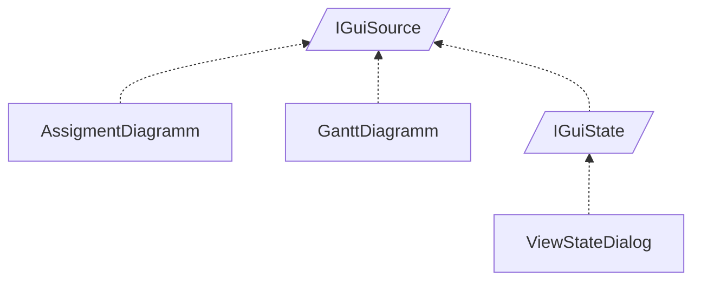

<!-- generated by Documentize RepoDocs @ 45dc6ae0049560c6948c19e6cfa8952044b68b0e -->
# IGuiSource

Interface [`IGuiSource`](../api/TaskManagerInterface/IGuiSource.md) in [GanttMonoTracker](../projects/GanttMonoTracker.md), with 4 types that implement or derive from it.

## How this family works

*Written by AI from the code at this commit. Check important details against the source.*

This contract enables the tracker core to inject task or assignment data into visual widgets without knowing their concrete types.

### Variants

| Type | Differs by | Use when |
|---|---|---|
| [`GanttMonoTracker.DrawingPresentation.GanttDiagramm`](../api/GanttMonoTracker.DrawingPresentation/GanttDiagramm.md) | Implements [`IGanttSource`](../api/GanttMonoTracker/IGanttSource.md) in addition to [`IGuiSource`](../api/TaskManagerInterface/IGuiSource.md), adds read‑only handling, static source fallback, and disposes drawing resources; draws a full Gantt chart. | You need a visual Gantt chart that can be refreshed, toggles read‑only mode, or uses a static data source. |
| [`GanttMonoTracker.DrawingPresentation.AssigmentDiagramm`](../api/GanttMonoTracker.DrawingPresentation/AssigmentDiagramm.md) | Implements only [`IGuiSource`](../api/TaskManagerInterface/IGuiSource.md); pulls assignment data from `TrackerCore.Instance.TaskManager.AssigmentSource` and draws a simpler assignment timeline. | You need a lightweight assignment view without the extra Gantt‑specific features. |
| [`GanttMonoTracker.GuiPresentation.ViewStateDialog`](../api/GanttMonoTracker.GuiPresentation/ViewStateDialog.md) | Implements [`IGuiState`](../api/TaskManagerInterface/IGuiState.md) (which extends [`IGuiSource`](../api/TaskManagerInterface/IGuiSource.md)) and [`IGuiMessageDialog`](../api/TaskManagerInterface/IGuiMessageDialog.md); provides a full dialog UI with many widgets for editing states, not a drawing area. | You need a modal dialog for creating, editing, or searching task states rather than a chart. |
| [`IGuiState`](../api/TaskManagerInterface/IGuiState.md) | Is an interface that extends [`IGuiSource`](../api/TaskManagerInterface/IGuiSource.md); adds state‑specific members (not shown) for dialogs that manage core state objects. | You are defining a new dialog or component that must expose both a data set and additional state‑management capabilities. |

### Adding a variant

Create a new class that implements [`IGuiSource`](../api/TaskManagerInterface/IGuiSource.md) (or [`IGuiState`](../api/TaskManagerInterface/IGuiState.md) if state handling is required). Optionally implement extra interfaces such as [`IGanttSource`](../api/GanttMonoTracker/IGanttSource.md) to gain additional behavior.

**Pitfalls**

- The `Source` property must be set before the widget's `OnExposeEvent` runs; otherwise drawing code may throw.
- Both [`GanttDiagramm`](../api/GanttMonoTracker.DrawingPresentation/GanttDiagramm.md) and [`AssigmentDiagramm`](../api/GanttMonoTracker.DrawingPresentation/AssigmentDiagramm.md) are sealed, so they cannot be subclassed for customization.
- [`GanttDiagramm`](../api/GanttMonoTracker.DrawingPresentation/GanttDiagramm.md) relies on a static source fallback; ensure `StaticSource` is correctly configured if you bypass the task manager.

## Types

| Type | Kind | Level | Project | |
|---|---|---:|---|---|
| [`AssigmentDiagramm`](../api/GanttMonoTracker.DrawingPresentation/AssigmentDiagramm.md) | Class | 1 | GanttMonoTracker |  |
| [`GanttDiagramm`](../api/GanttMonoTracker.DrawingPresentation/GanttDiagramm.md) | Class | 1 | GanttMonoTracker |  |
| [`IGuiState`](../api/TaskManagerInterface/IGuiState.md) | Interface | 1 | GanttMonoTracker |  |
| [`ViewStateDialog`](../api/GanttMonoTracker.GuiPresentation/ViewStateDialog.md) | Class | 2 | GanttMonoTracker |  |
