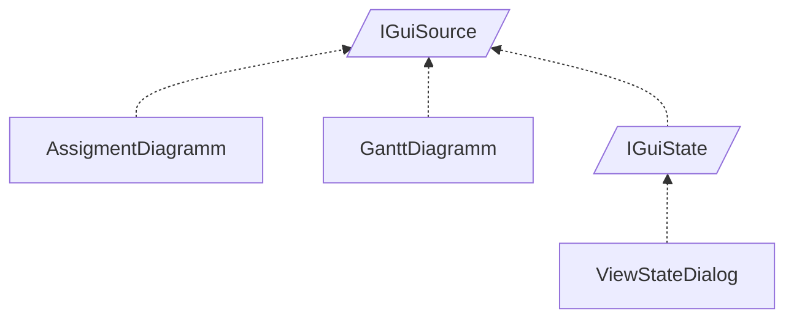

<!-- generated by Documentize RepoDocs @ 45dc6ae0049560c6948c19e6cfa8952044b68b0e -->
# IGuiSource

Interface [`IGuiSource`](../api/TaskManagerInterface/IGuiSource.md) in [GanttMonoTracker](../projects/GanttMonoTracker.md), with 4 types that implement or derive from it.

## Types

| Type | Kind | Level | Project | |
|---|---|---:|---|---|
| [`AssigmentDiagramm`](../api/GanttMonoTracker.DrawingPresentation/AssigmentDiagramm.md) | Class | 1 | GanttMonoTracker |  |
| [`GanttDiagramm`](../api/GanttMonoTracker.DrawingPresentation/GanttDiagramm.md) | Class | 1 | GanttMonoTracker |  |
| [`IGuiState`](../api/TaskManagerInterface/IGuiState.md) | Interface | 1 | GanttMonoTracker |  |
| [`ViewStateDialog`](../api/GanttMonoTracker.GuiPresentation/ViewStateDialog.md) | Class | 2 | GanttMonoTracker |  |
