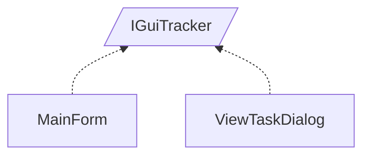

<!-- generated by Documentize RepoDocs @ 45dc6ae0049560c6948c19e6cfa8952044b68b0e -->
# IGuiTracker

Interface [`IGuiTracker`](../api/TaskManagerInterface/IGuiTracker.md) in [GanttMonoTracker](../projects/GanttMonoTracker.md), with 2 types that implement or derive from it.

## How this family works

*Written by AI from the code at this commit. Check important details against the source.*

[`IGuiTracker`](../api/TaskManagerInterface/IGuiTracker.md) defines the contract for UI components that expose three data sources—actors, states, and tasks—and provide methods to bind each source to the visual controls. The family exists so the application can present the same data model through different windows or dialogs without duplicating binding logic.

### Variants

| Type | Differs by | Use when |
|---|---|---|
| [`MainForm`](../api/GanttMonoTracker.GuiPresentation/MainForm.md) |  | Use for the primary, always‑visible interface that manages the full project lifecycle. |
| [`ViewTaskDialog`](../api/GanttMonoTracker.GuiPresentation/ViewTaskDialog.md) | Implements [`IGuiTracker`](../api/TaskManagerInterface/IGuiTracker.md) in a modal dialog; binds data to combo boxes, calendars, and text fields for editing a single task. | Use when a user needs to view or edit details of one task without leaving the main window. |

### Adding a variant

Create a new UI class that implements [`IGuiTracker`](../api/TaskManagerInterface/IGuiTracker.md).

### Creating and registering

Implementations are instantiated directly in code (e.g., `new MainForm()` or `new ViewTaskDialog(parent, ...)`). No DI registration is present for [`IGuiTracker`](../api/TaskManagerInterface/IGuiTracker.md) in the current code base.

**Pitfalls**

- [`ViewTaskDialog`](../api/GanttMonoTracker.GuiPresentation/ViewTaskDialog.md) also implements [`IGuiTask`](../api/TaskManagerInterface/IGuiTask.md); ensure you satisfy both interfaces if you reuse the dialog elsewhere.

## Types

| Type | Kind | Level | Project | |
|---|---|---:|---|---|
| [`MainForm`](../api/GanttMonoTracker.GuiPresentation/MainForm.md) | Class | 1 | GanttMonoTracker |  |
| [`ViewTaskDialog`](../api/GanttMonoTracker.GuiPresentation/ViewTaskDialog.md) | Class | 1 | GanttMonoTracker |  |
