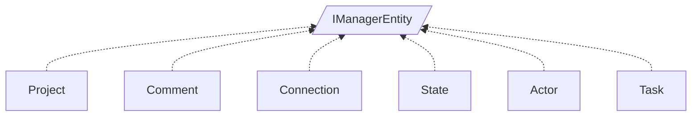

<!-- generated by Documentize RepoDocs @ 45dc6ae0049560c6948c19e6cfa8952044b68b0e -->
# IManagerEntity

Interface [`IManagerEntity`](../api/TaskManagerInterface/IManagerEntity.md) in [GanttMonoTracker](../projects/GanttMonoTracker.md), with 6 types that implement or derive from it.

## How this family works

*Written by AI from the code at this commit. Check important details against the source.*

[`IManagerEntity`](../api/TaskManagerInterface/IManagerEntity.md) defines the minimal contract for any persistable domain object in the GanttMonoTracker model: a unique `Id`, flags `IsNew` and `isUpdated`, a reference to its owning [`ITaskManager`](../api/TaskManagerInterface/ITaskManager.md) (`Parent`), and the lifecycle operations `BindData()`, `Save()` and `Delete()`. The family exists so the task manager can treat projects, tasks, comments, states, actors and connections uniformly when loading, saving or deleting them.

### Variants

| Type | Differs by | Use when |
|---|---|---|
| [`Project`](../api/GanttMonoTracker/Project.md) |  | you need to create, load or delete an entire project hierarchy. |
| [`Task`](../api/GanttTracker.TaskManager/Task.md) | holds scheduling data (start/end, estimated time) and links to an [`Actor`](../api/GanttTracker.TaskManager/Actor.md) and a [`State`](../api/GanttTracker.StateManager/State.md); `IsNew` is computed from `Id`, and `Save/Delete` delegate to the parent manager’s task methods. | you need a work item that can be scheduled, assigned and tracked. |
| [`Comment`](../api/GanttTracker.CommentManager/Comment.md) | stores free‑form text attached to any other [`IManagerEntity`](../api/TaskManagerInterface/IManagerEntity.md); it tracks the commented entity via `CommentedEntity`/`CommentedEntryID` and sets `IsNew` based on constructor usage. | you need user notes linked to a task, state, project, etc. |
| [`State`](../api/GanttTracker.StateManager/State.md) |  | you need a workflow step that can be linked to other steps. |
| [`Actor`](../api/GanttTracker.TaskManager/Actor.md) | represents a resource/person; typically contains personal data (not shown) and participates in task assignment; otherwise follows the same [`IManagerEntity`](../api/TaskManagerInterface/IManagerEntity.md) contract. | you need to assign a task to a user or resource. |
| [`Connection`](../api/GanttTracker.StateManager/Connection.md) | models a relationship between two [`IManagerEntity`](../api/TaskManagerInterface/IManagerEntity.md) instances (e.g., linking a task to a state); its payload is the target entity and a descriptive name; it does not carry its own business data beyond the link. | you need an explicit edge in the Gantt graph separate from the built‑in state connections. |

### Adding a variant

To add a new variant, create a public class that implements [`IManagerEntity`](../api/TaskManagerInterface/IManagerEntity.md) (or derives from an existing concrete variant). Implement the `Id`, `IsNew`, `isUpdated`, `Parent` properties and the three lifecycle methods. Optionally add domain‑specific members and override `IsNew`/`isUpdated` logic as needed.

### Creating and registering

The code base does not register the variants through a central DI container; they are instantiated directly by the [`ITaskManager`](../api/TaskManagerInterface/ITaskManager.md) implementations (e.g., `new Task(parent)`, `new Comment(parent, entity)`). If a DI registration is added, it should map the concrete type to [`IManagerEntity`](../api/TaskManagerInterface/IManagerEntity.md) or to a more specific service interface.

**Pitfalls**

- `State.Connect` casts the target to [`State`](../api/GanttTracker.StateManager/State.md); passing a non‑state entity causes an invalid cast exception.
- `Comment.CommentedEntryID` throws if the referenced entry is not present, so callers must set `CommentedEntity` first or handle the exception.

## Types

| Type | Kind | Level | Project | |
|---|---|---:|---|---|
| [`Project`](../api/GanttMonoTracker/Project.md) | Class | 1 | GanttMonoTracker |  |
| [`Comment`](../api/GanttTracker.CommentManager/Comment.md) | Class | 1 | GanttMonoTracker |  |
| [`Connection`](../api/GanttTracker.StateManager/Connection.md) | Class | 1 | GanttMonoTracker |  |
| [`State`](../api/GanttTracker.StateManager/State.md) | Class | 1 | GanttMonoTracker |  |
| [`Actor`](../api/GanttTracker.TaskManager/Actor.md) | Class | 1 | GanttMonoTracker |  |
| [`Task`](../api/GanttTracker.TaskManager/Task.md) | Class | 1 | GanttMonoTracker |  |
