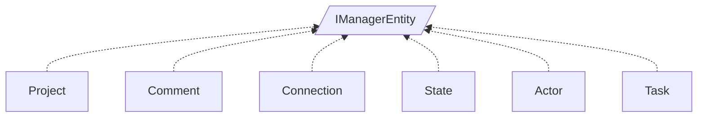

<!-- generated by Documentize RepoDocs @ 45dc6ae0049560c6948c19e6cfa8952044b68b0e -->
# IManagerEntity

Interface [`IManagerEntity`](../api/TaskManagerInterface/IManagerEntity.md) in [GanttMonoTracker](../projects/GanttMonoTracker.md), with 6 types that implement or derive from it.

## Types

| Type | Kind | Level | Project | |
|---|---|---:|---|---|
| [`Project`](../api/GanttMonoTracker/Project.md) | Class | 1 | GanttMonoTracker |  |
| [`Comment`](../api/GanttTracker.CommentManager/Comment.md) | Class | 1 | GanttMonoTracker |  |
| [`Connection`](../api/GanttTracker.StateManager/Connection.md) | Class | 1 | GanttMonoTracker |  |
| [`State`](../api/GanttTracker.StateManager/State.md) | Class | 1 | GanttMonoTracker |  |
| [`Actor`](../api/GanttTracker.TaskManager/Actor.md) | Class | 1 | GanttMonoTracker |  |
| [`Task`](../api/GanttTracker.TaskManager/Task.md) | Class | 1 | GanttMonoTracker |  |
