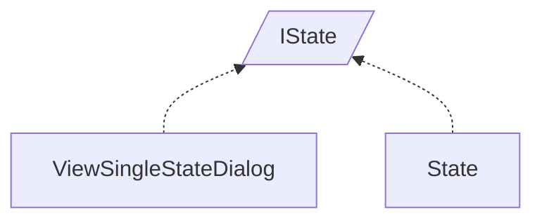

<!-- generated by Documentize RepoDocs @ 45dc6ae0049560c6948c19e6cfa8952044b68b0e -->
# IState

Interface [`IState`](../api/TaskManagerInterface/IState.md) in [GanttMonoTracker](../projects/GanttMonoTracker.md), with 2 types that implement or derive from it.

## How this family works

*Written by AI from the code at this commit. Check important details against the source.*

[`IState`](../api/TaskManagerInterface/IState.md) defines the data contract for a state entity: color components, name, mapping information, connection management, and basic lifecycle methods. The family exists to separate UI‑focused state handling from core domain state objects while sharing the same contract.

### Variants

| Type | Differs by | Use when |
|---|---|---|
| [`ViewSingleStateDialog`](../api/GanttMonoTracker.GuiPresentation/ViewSingleStateDialog.md) | Provides a GUI dialog, implements [`IGuiMessageDialog`](../api/TaskManagerInterface/IGuiMessageDialog.md) and `IDisposable`, stores color values via UI widgets, and is used for creating or editing a state through user interaction. | When a state must be presented or edited in the graphical interface. |
| [`State`](../api/GanttTracker.StateManager/State.md) | Is a pure domain model, implements [`IManagerEntity`](../api/TaskManagerInterface/IManagerEntity.md), stores data in plain properties, validates mapping access, and manages connections without any UI code. | When a state is needed for business logic, persistence, or task‑manager operations. |

### Adding a variant

Create a new variant by implementing [`IState`](../api/TaskManagerInterface/IState.md) (and optionally additional interfaces such as [`IGuiMessageDialog`](../api/TaskManagerInterface/IGuiMessageDialog.md) or [`IManagerEntity`](../api/TaskManagerInterface/IManagerEntity.md)). Provide concrete getters/setters for the contract members and implement connection logic as required. No base class is required; only the interface contract must be satisfied.

### Creating and registering

Variants are instantiated directly by the code that needs them (e.g., `new ViewSingleStateDialog(parent)` for UI, `new State(parent)` for domain). No DI container registrations for [`IState`](../api/TaskManagerInterface/IState.md) are present in the current code base.

**Pitfalls**

- Mixing UI logic into a domain [`State`](../api/GanttTracker.StateManager/State.md) breaks separation of concerns.
- [`ViewSingleStateDialog`](../api/GanttMonoTracker.GuiPresentation/ViewSingleStateDialog.md) does not persist changes; callers must transfer its property values to a [`State`](../api/GanttTracker.StateManager/State.md) instance.

## Types

| Type | Kind | Level | Project | |
|---|---|---:|---|---|
| [`ViewSingleStateDialog`](../api/GanttMonoTracker.GuiPresentation/ViewSingleStateDialog.md) | Class | 1 | GanttMonoTracker |  |
| [`State`](../api/GanttTracker.StateManager/State.md) | Class | 1 | GanttMonoTracker |  |
