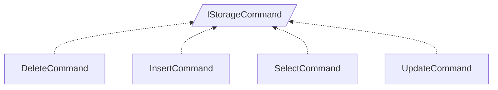

<!-- generated by Documentize RepoDocs @ 45dc6ae0049560c6948c19e6cfa8952044b68b0e -->
# IStorageCommand

Interface [`IStorageCommand`](../api/TaskManagerInterface/IStorageCommand.md) in [GanttMonoTracker](../projects/GanttMonoTracker.md), with 4 types that implement or derive from it.

## Types

| Type | Kind | Level | Project | |
|---|---|---:|---|---|
| [`DeleteCommand`](../api/GanttTracker.TaskManager.TaskStorage/DeleteCommand.md) | Class | 1 | GanttMonoTracker |  |
| [`InsertCommand`](../api/GanttTracker.TaskManager.TaskStorage/InsertCommand.md) | Class | 1 | GanttMonoTracker |  |
| [`SelectCommand`](../api/GanttTracker.TaskManager.TaskStorage/SelectCommand.md) | Class | 1 | GanttMonoTracker |  |
| [`UpdateCommand`](../api/GanttTracker.TaskManager.TaskStorage/UpdateCommand.md) | Class | 1 | GanttMonoTracker |  |
