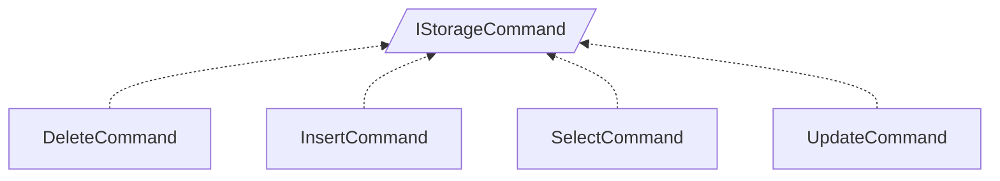

<!-- generated by Documentize RepoDocs @ 45dc6ae0049560c6948c19e6cfa8952044b68b0e -->
# IStorageCommand

Interface [`IStorageCommand`](../api/TaskManagerInterface/IStorageCommand.md) in [GanttMonoTracker](../projects/GanttMonoTracker.md), with 4 types that implement or derive from it.

## How this family works

*Written by AI from the code at this commit. Check important details against the source.*

[`IStorageCommand`](../api/TaskManagerInterface/IStorageCommand.md) defines a small command contract: callers set named parameters, can query their presence, and invoke `Execute` which performs the operation after `CheckParams` validates required keys.

### Variants

| Type | Differs by | Use when |
|---|---|---|
| [`DeleteCommand`](../api/GanttTracker.TaskManager.TaskStorage/DeleteCommand.md) |  | need to remove rows from a table based on filter rules |
| [`InsertCommand`](../api/GanttTracker.TaskManager.TaskStorage/InsertCommand.md) |  | need to add a new record to a table |
| [`SelectCommand`](../api/GanttTracker.TaskManager.TaskStorage/SelectCommand.md) |  | need to retrieve rows matching criteria |
| [`UpdateCommand`](../api/GanttTracker.TaskManager.TaskStorage/UpdateCommand.md) |  | need to modify existing rows according to filter rules |

### Adding a variant

To add a new variant, create a class that implements [`IStorageCommand`](../api/TaskManagerInterface/IStorageCommand.md).

### Creating and registering

The commands are instantiated directly via their public constructors; there are no DI registrations for [`IStorageCommand`](../api/TaskManagerInterface/IStorageCommand.md) in the code base.

**Pitfalls**

- Missing required keys causes `CheckParams` to throw [`KeyNotFoundException`](../api/GanttTracker.TaskManager.ManagerException/KeyNotFoundException-1.md) at runtime
- `Execute` may throw if the target table does not exist or if rule processing fails

## Types

| Type | Kind | Level | Project | |
|---|---|---:|---|---|
| [`DeleteCommand`](../api/GanttTracker.TaskManager.TaskStorage/DeleteCommand.md) | Class | 1 | GanttMonoTracker |  |
| [`InsertCommand`](../api/GanttTracker.TaskManager.TaskStorage/InsertCommand.md) | Class | 1 | GanttMonoTracker |  |
| [`SelectCommand`](../api/GanttTracker.TaskManager.TaskStorage/SelectCommand.md) | Class | 1 | GanttMonoTracker |  |
| [`UpdateCommand`](../api/GanttTracker.TaskManager.TaskStorage/UpdateCommand.md) | Class | 1 | GanttMonoTracker |  |
