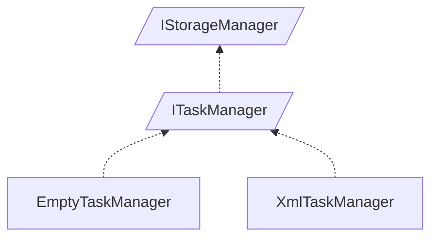

<!-- generated by Documentize RepoDocs @ 45dc6ae0049560c6948c19e6cfa8952044b68b0e -->
# IStorageManager

Interface [`IStorageManager`](../api/TaskManagerInterface/IStorageManager.md) in [GanttMonoTracker](../projects/GanttMonoTracker.md), with 3 types that implement or derive from it.

## Types

| Type | Kind | Level | Project | |
|---|---|---:|---|---|
| [`ITaskManager`](../api/TaskManagerInterface/ITaskManager.md) | Interface | 1 | GanttMonoTracker |  |
| [`EmptyTaskManager`](../api/GanttTracker.TaskManager/EmptyTaskManager.md) | Class | 2 | GanttMonoTracker |  |
| [`XmlTaskManager`](../api/GanttTracker.TaskManager/XmlTaskManager.md) | Class | 2 | GanttMonoTracker |  |

## Smaller families inside

- [`ITaskManager`](ITaskManager.md): 2 types
