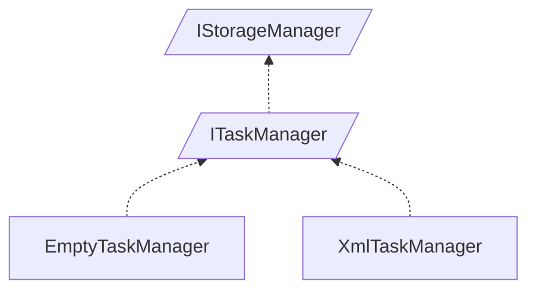

<!-- generated by Documentize RepoDocs @ 45dc6ae0049560c6948c19e6cfa8952044b68b0e -->
# IStorageManager

Interface [`IStorageManager`](../api/TaskManagerInterface/IStorageManager.md) in [GanttMonoTracker](../projects/GanttMonoTracker.md), with 3 types that implement or derive from it.

## How this family works

*Written by AI from the code at this commit. Check important details against the source.*

[`IStorageManager`](../api/TaskManagerInterface/IStorageManager.md) guarantees that a storage component can persist changes (`Save`) and apply updates via a supplied [`IStorageRepository`](../api/TaskManagerInterface/IStorageRepository.md). It serves as the minimal contract for any data‑backed manager, allowing higher‑level managers to focus on domain operations while delegating persistence concerns.

### Variants

| Type | Differs by | Use when |
|---|---|---|
| [`GanttTracker.TaskManager.EmptyTaskManager`](../api/GanttTracker.TaskManager/EmptyTaskManager.md) | Provides a no‑op implementation that returns empty datasets and throws [`ManagementException`](../api/GanttTracker.TaskManager.ManagerException/ManagementException.md) for all mutating operations; useful for unit tests or scenarios where storage is intentionally disabled. | When you need a lightweight stub that satisfies the interface without accessing a database or file system. |
| [`GanttTracker.TaskManager.XmlTaskManager`](../api/GanttTracker.TaskManager/XmlTaskManager.md) | Creates a real [`StorageRepository`](../api/GanttTracker.TaskManager.TaskStorage/StorageRepository.md) using a connection string, validates the connection, loads data, and implements full CRUD operations on tasks, actors, and states. | When the application must persist and retrieve actual Gantt data from an XML‑backed storage layer. |

### Adding a variant

To add a new variant, create a class that implements [`ITaskManager`](../api/TaskManagerInterface/ITaskManager.md) (or directly [`IStorageManager`](../api/TaskManagerInterface/IStorageManager.md) if only `Save`/`Update` are needed). Implement `Save`, `Update`, and all members of [`ITaskManager`](../api/TaskManagerInterface/ITaskManager.md). The class can be instantiated manually or registered in the DI container as a singleton or scoped service for [`ITaskManager`](../api/TaskManagerInterface/ITaskManager.md). No abstract base class is required; the interface defines the contract.

### Creating and registering

New implementations can be added to DI using the project's standard registration pattern for services implementing [`ITaskManager`](../api/TaskManagerInterface/ITaskManager.md).

**Pitfalls**

- [`EmptyTaskManager`](../api/GanttTracker.TaskManager/EmptyTaskManager.md) throws [`ManagementException`](../api/GanttTracker.TaskManager.ManagerException/ManagementException.md) for any operation that modifies data, so using it in production will cause runtime failures.
- [`XmlTaskManager`](../api/GanttTracker.TaskManager/XmlTaskManager.md) requires a valid connection string; an invalid one triggers a [`ManagementException`](../api/GanttTracker.TaskManager.ManagerException/ManagementException.md) during construction.
- Both implementations rely on [`StorageRepository`](../api/GanttTracker.TaskManager.TaskStorage/StorageRepository.md) and [`CommandFactory`](../api/GanttTracker.TaskManager.TaskStorage/CommandFactory.md); changes to those dependencies may require updates to the manager implementations.

## Types

| Type | Kind | Level | Project | |
|---|---|---:|---|---|
| [`ITaskManager`](../api/TaskManagerInterface/ITaskManager.md) | Interface | 1 | GanttMonoTracker |  |
| [`EmptyTaskManager`](../api/GanttTracker.TaskManager/EmptyTaskManager.md) | Class | 2 | GanttMonoTracker |  |
| [`XmlTaskManager`](../api/GanttTracker.TaskManager/XmlTaskManager.md) | Class | 2 | GanttMonoTracker |  |

## Smaller families inside

- [`ITaskManager`](ITaskManager.md): 2 types
