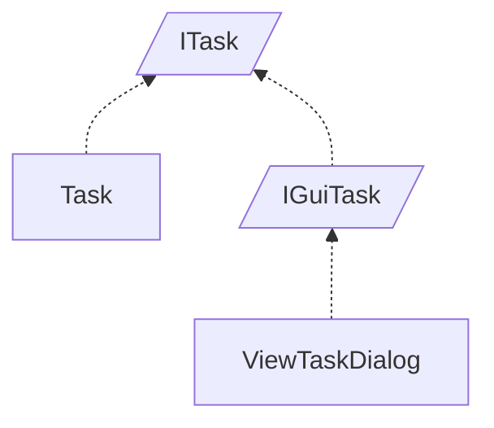

<!-- generated by Documentize RepoDocs @ 45dc6ae0049560c6948c19e6cfa8952044b68b0e -->
# ITask

Interface [`ITask`](../api/TaskManagerInterface/ITask.md) in [GanttMonoTracker](../projects/GanttMonoTracker.md), with 3 types that implement or derive from it.

## How this family works

*Written by AI from the code at this commit. Check important details against the source.*

The [`ITask`](../api/TaskManagerInterface/ITask.md) interface defines the minimal data contract for a scheduled work item: identifiers for actor and state, a description, and start/end timestamps. It exists so that core logic (e.g., managers, persistence, UI) can operate on any concrete task representation without depending on a specific class.

### Variants

| Type | Differs by | Use when |
|---|---|---|
| [`Task`](../api/GanttTracker.TaskManager/Task.md) | Implements [`ITask`](../api/TaskManagerInterface/ITask.md) and adds management‑specific members (Id, IsNew, isUpdated, Parent, Comment, Priority, EstimatedTime) plus persistence methods (BindData, Save, Delete). It also validates actor and state presence. | Use when you need a full domain entity that can be stored, updated, or deleted by an [`ITaskManager`](../api/TaskManagerInterface/ITaskManager.md). |
| [`IGuiTask`](../api/TaskManagerInterface/IGuiTask.md) | Extends [`ITask`](../api/TaskManagerInterface/ITask.md) with UI‑specific contract (`Priority` and inherits [`IGuiMessageDialog`](../api/TaskManagerInterface/IGuiMessageDialog.md)). It does not provide implementation, only adds read‑only UI data. | Use when a component only needs to display task information (e.g., dialogs, trackers) without modifying persistence state. |
| [`ViewTaskDialog`](../api/GanttMonoTracker.GuiPresentation/ViewTaskDialog.md) | Concrete class that implements [`IGuiTask`](../api/TaskManagerInterface/IGuiTask.md) and [`IGuiTracker`](../api/TaskManagerInterface/IGuiTracker.md); supplies GTK# widgets, loads a Glade UI file, and maps UI controls to the [`ITask`](../api/TaskManagerInterface/ITask.md) properties. It does not contain persistence logic. | Use when you need a dialog window that lets the user view or edit a task in the graphical interface. |

### Adding a variant

To add a new variant, create a class (or interface) that implements [`ITask`](../api/TaskManagerInterface/ITask.md). For UI variants, also implement [`IGuiTask`](../api/TaskManagerInterface/IGuiTask.md) or another UI‑specific interface. Provide the required property getters/setters and any additional behavior (e.g., persistence, validation, rendering). No base class is required; only the contract must be satisfied.

### Creating and registering

No DI registration for [`ITask`](../api/TaskManagerInterface/ITask.md) variants is present in the current code base.

**Pitfalls**

- [`Task`](../api/GanttTracker.TaskManager/Task.md) throws [`ManagementException`](../api/GanttTracker.TaskManager.ManagerException/ManagementException.md) if `ActorPresent` or `StatePresent` is false; callers must set these flags before reading the IDs.
- [`ViewTaskDialog`](../api/GanttMonoTracker.GuiPresentation/ViewTaskDialog.md) tightly couples to Glade resources; moving the UI file or changing widget names will break the dialog.
- [`IGuiTask`](../api/TaskManagerInterface/IGuiTask.md) only exposes a read‑only `Priority`; attempting to modify it requires casting to the concrete [`Task`](../api/GanttTracker.TaskManager/Task.md) type.

## Types

| Type | Kind | Level | Project | |
|---|---|---:|---|---|
| [`Task`](../api/GanttTracker.TaskManager/Task.md) | Class | 1 | GanttMonoTracker |  |
| [`IGuiTask`](../api/TaskManagerInterface/IGuiTask.md) | Interface | 1 | GanttMonoTracker |  |
| [`ViewTaskDialog`](../api/GanttMonoTracker.GuiPresentation/ViewTaskDialog.md) | Class | 2 | GanttMonoTracker |  |
