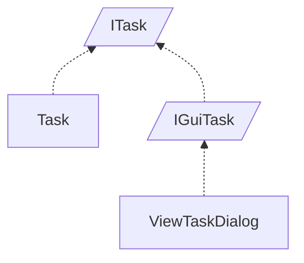

<!-- generated by Documentize RepoDocs @ 45dc6ae0049560c6948c19e6cfa8952044b68b0e -->
# ITask

Interface [`ITask`](../api/TaskManagerInterface/ITask.md) in [GanttMonoTracker](../projects/GanttMonoTracker.md), with 3 types that implement or derive from it.

## Types

| Type | Kind | Level | Project | |
|---|---|---:|---|---|
| [`Task`](../api/GanttTracker.TaskManager/Task.md) | Class | 1 | GanttMonoTracker |  |
| [`IGuiTask`](../api/TaskManagerInterface/IGuiTask.md) | Interface | 1 | GanttMonoTracker |  |
| [`ViewTaskDialog`](../api/GanttMonoTracker.GuiPresentation/ViewTaskDialog.md) | Class | 2 | GanttMonoTracker |  |
