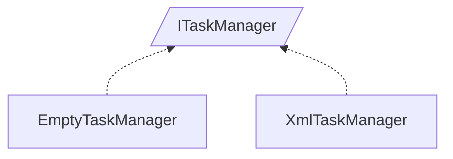

<!-- generated by Documentize RepoDocs @ 45dc6ae0049560c6948c19e6cfa8952044b68b0e -->
# ITaskManager

Interface [`ITaskManager`](../api/TaskManagerInterface/ITaskManager.md) in [GanttMonoTracker](../projects/GanttMonoTracker.md), with 2 types that implement or derive from it.

Part of the larger family [IStorageManager](IStorageManager.md).

## How this family works

*Written by AI from the code at this commit. Check important details against the source.*

[`ITaskManager`](../api/TaskManagerInterface/ITaskManager.md) defines the contract for task‑related storage: it exposes datasets for actors, tasks, states, and Gantt ranges, and provides methods to create, retrieve, bind, check updates, and delete entities. The family exists to supply interchangeable storage back‑ends (real database or stub) while keeping the rest of the application agnostic of the source.

### Variants

| Type | Differs by | Use when |
|---|---|---|
| [`XmlTaskManager`](../api/GanttTracker.TaskManager/XmlTaskManager.md) | uses a [`StorageRepository`](../api/GanttTracker.TaskManager.TaskStorage/StorageRepository.md) backed by a connection string, loads data from persistent storage, and implements full CRUD operations; setters on datasets are prohibited | a live database is available and the application needs persistent task data |
| [`EmptyTaskManager`](../api/GanttTracker.TaskManager/EmptyTaskManager.md) | uses an in‑memory `EmptyStorage` repository, returns pre‑filled empty datasets, and throws [`ManagementException`](../api/GanttTracker.TaskManager.ManagerException/ManagementException.md) for most mutating operations | running in a test, demo, or offline scenario where no persistent storage should be accessed |

### Adding a variant

To add a new variant, create a class that implements [`ITaskManager`](../api/TaskManagerInterface/ITaskManager.md) (or inherits from an existing implementation) and provide concrete logic for the required members. At minimum, supply a [`IStorageRepository`](../api/TaskManagerInterface/IStorageRepository.md) and implement dataset getters, entity factories, and CRUD methods appropriate to the storage strategy.

### Creating and registering

To enable DI, register the desired implementation with the container in the composition root.

**Pitfalls**

- [`EmptyTaskManager`](../api/GanttTracker.TaskManager/EmptyTaskManager.md) throws [`ManagementException`](../api/GanttTracker.TaskManager.ManagerException/ManagementException.md) for create, update, and delete operations, so calling code must guard against unsupported actions
- [`XmlTaskManager`](../api/GanttTracker.TaskManager/XmlTaskManager.md) constructor validates the connection string and will throw if the database cannot be reached
- Both implementations expose mutable dataset properties that may be misused; setters are either no‑ops or prohibited

## Types

| Type | Kind | Level | Project | |
|---|---|---:|---|---|
| [`EmptyTaskManager`](../api/GanttTracker.TaskManager/EmptyTaskManager.md) | Class | 1 | GanttMonoTracker |  |
| [`XmlTaskManager`](../api/GanttTracker.TaskManager/XmlTaskManager.md) | Class | 1 | GanttMonoTracker |  |
